# Arquitectura

## Flujo de datos

El proyecto integra **5 fuentes** en un único esquema estrella conformado: CAPCOL
(Superbancos, con sus sub-portales de bancos privados y de Banca Pública), BCE tsp/tsa,
BCE `TasasHistorico.htm`, el Boletín Financiero de Superbancos y la SEPS (cooperativas y
mutualistas). Las tablas de hechos mezclan tipos de entidad: todo consumidor debe filtrar
o agrupar por `dim_entidad.tipo_entidad`.
Cada fuente tiene su propio extractor/parser, pero todas convergen en la misma capa
`marts.*` — la identidad de banco y los catálogos de producto/plazo son compartidos
(resueltos en Python antes de `staging.*`, ver sección "Catálogos conformados" abajo).

**Banca Pública** (`capcol-instituciones-publicas/`):
mismo plugin/formato/grano que `capcol-bancos` — no es un sub-flujo nuevo en el diagrama de
abajo, es CAPCOL cargando `tipo_entidad='BANCO PUBLICO'` además de `'BANCO PRIVADO'` en
`staging.cartera`/`staging.depositos` → `fact_saldo_cartera`/`fact_saldo_depositos`
(`--portales publica`, `config.CAPCOL_PORTALES`). Sin migraciones de esquema. Detalle e
identidad en `docs/fuentes_datos.md` sección 1.

**SEPS** (cooperativas S1-S3 + mutualistas, `uv run benchmark-bancos seps`): descarga
directa (`src/benchmark_bancos/extract/download_seps.py`, sin Playwright) de 3 ZIP por año, parseados por
`src/benchmark_bancos/transform/parse_seps.py`. **No agrega tablas**: captaciones entra a
`staging.depositos` → `fact_saldo_depositos`, colocaciones (que son saldos) a
`staging.cartera` → `fact_saldo_cartera`, y los estados financieros a
`staging.boletin_balance/pyg` → `fact_balance`/`fact_pyg`. La identidad es el RUC del
archivo, con la misma llave `BCE_<ruc>` que BCE ya había auto-registrado. Solo hubo tres
migraciones: `sql/29` (tipo `ENTIDAD DE SEGUNDO PISO`), `sql/30` (categoría
`DEPÓSITOS A LA VISTA`) y `sql/31` (`provincia` en la llave natural de staging, porque hay
cantones homónimos que la SEPS sí reporta en el mismo mes).

```
CAPCOL privados + Banca Pública   BCE tsp/tsa          TasasHistorico.htm     Boletín BALANCE/PYG    SEPS (cartera, depósitos, EEFF)
Playwright (Share-one-Drive)      descarga directa     descarga directa       Playwright             descarga directa
scrape_superbancos.py             download_bce.py      download_tasas_        scrape_boletin.py      download_seps.py
        │                                │             historicas.py                 │                      │
        ▼                                ▼                    ▼                       ▼                      ▼
data/raw/{anio}/, banca_publica/  data/raw/bce/        data/raw/bce/historico/ data/raw/{anio}/boletin/ data/raw/seps/{anio}/
        │  parse_cartera/depositos       │ parse_bce_tasas     │ parse_tasas_hist.       │ parse_boletin         │ parse_seps
        └────────────────────────────────┴────────────────────┴─────────────────────────┴───────────────────────┘
        │  meta.source_files: sha256 por archivo (un archivo ya cargado no se reprocesa)
        │  COPY a tabla temporal + INSERT ... ON CONFLICT ... WHERE (cols) IS DISTINCT FROM (EXCLUDED cols)
        ▼
staging.*   (tipado, banco_codigo/categoría/segmento/cantón ya resueltos, fecha_carga/fecha_actualizacion)
        │  refresh_marts(): SQL puro, idempotente, INCREMENTAL por marca de agua (meta.refresh_watermark)
        ▼
marts.dim_* / marts.fact_* / marts.vw_*   (esquema estrella: 10 dimensiones, 10 hechos, 16 vistas)
        │
        ▼
BI (cualquier herramienta, Import/DirectQuery desde Postgres)
```

## Modelo de datos (esquema estrella)

10 dimensiones y 10 tablas de hechos en `marts.*`, resultado final del flujo anterior.
`dim_fecha`/`dim_entidad` son compartidas por casi todas las fuentes; `dim_canton`,
`dim_provincia`, `dim_segmento_credito`, `dim_subsegmento_credito`, `dim_segmento_entidad`,
`dim_categoria_deposito`, `dim_plazo` y `dim_cuenta_contable` son compartidas solo por las
fuentes que las necesitan (ver "Catálogos conformados" abajo). `dim_provincia` y
`dim_segmento_entidad` son outriggers de `dim_canton`/`dim_entidad`
respectivamente. **`dim_canton` es FK directa tanto de CAPCOL (`fact_saldo_cartera`/
`fact_saldo_depositos`) como de BCE tsp/tsa (`fact_captaciones_depositos`/
`fact_colocaciones_cartera`)**: provincia y región se alcanzan por el mismo snowflake
(`canton_id → dim_provincia`), con una sola convención de geografía. Detalle de cada columna en
`docs/data_dictionary.md`.

```mermaid
erDiagram
    dim_fecha {
        int fecha_id PK
        date fecha
        int anio
        int mes
        int trimestre
        int anio_mes
    }
    dim_entidad {
        int entidad_id PK
        string banco_codigo
        string banco
        string tipo_entidad
        string ruc
        int segmento_entidad_id FK
        string estado_validacion
    }
    dim_provincia {
        int provincia_id PK
        string provincia
        string region
    }
    dim_canton {
        int canton_id PK
        string canton
        int provincia_id FK
        string estado_validacion
    }
    dim_segmento_entidad {
        int segmento_entidad_id PK
        string tipo_segmento
    }
    dim_segmento_credito {
        int segmento_id PK
        string segmento
    }
    dim_subsegmento_credito {
        int subsegmento_id PK
        string subsegmento
        int segmento_id FK
    }
    dim_categoria_deposito {
        int categoria_deposito_id PK
        string categoria
    }
    dim_plazo {
        int plazo_id PK
        int dias_desde
        int dias_hasta
        string plazo_codigo
        string estado_validacion
    }
    dim_cuenta_contable {
        int cuenta_id PK
        string reporte
        string codigo
        string cuenta
        int nivel
        string codigo_padre
        string seccion
        string grupo_met
        string estado_validacion
    }

    fact_saldo_cartera {
        int fecha_id FK
        int entidad_id FK
        int canton_id FK
        int segmento_id FK
        numeric saldo_por_vencer
        numeric saldo_no_devenga_intereses
        numeric saldo_vencida
        numeric saldo_total
    }
    fact_saldo_depositos {
        int fecha_id FK
        int entidad_id FK
        int canton_id FK
        int categoria_deposito_id FK
        int plazo_id FK
        numeric saldo
        bigint numero_cuentas
        bigint numero_clientes
    }
    fact_captaciones_depositos {
        int fecha_id FK
        int entidad_id FK
        int categoria_deposito_id FK
        int plazo_id FK
        int canton_id FK
        int segmento_entidad_id FK
        numeric monto_total
        numeric tasa_pasiva_efectiva
    }
    fact_colocaciones_cartera {
        int fecha_id FK
        int entidad_id FK
        int subsegmento_id FK
        int plazo_id FK
        int canton_id FK
        int segmento_entidad_id FK
        numeric monto_total
        numeric tasa_activa_efectiva
    }
    fact_tasas_referenciales_cartera {
        int fecha_id FK
        int subsegmento_id FK
        numeric tasa_activa_maxima
        numeric tasa_activa_referencial
    }
    fact_tasas_referenciales_depositos_instrumento {
        int fecha_id FK
        int categoria_deposito_id FK
        numeric tasa_pasiva_promedio
    }
    fact_tasas_referenciales_depositos_plazo {
        int fecha_id FK
        int plazo_id FK
        numeric tasa_pasiva_referencial
    }
    fact_tasas_referenciales_sistema {
        int fecha_id PK
        numeric tasa_pasiva_referencial_sistema
        numeric tasa_activa_referencial_sistema
    }
    fact_balance {
        int fecha_id FK
        int entidad_id FK
        int cuenta_id FK
        numeric saldo_usd
    }
    fact_pyg {
        int fecha_id FK
        int entidad_id FK
        int cuenta_id FK
        numeric valor_usd
    }

    dim_fecha ||--o{ fact_saldo_cartera : fecha_id
    dim_fecha ||--o{ fact_saldo_depositos : fecha_id
    dim_fecha ||--o{ fact_captaciones_depositos : fecha_id
    dim_fecha ||--o{ fact_colocaciones_cartera : fecha_id
    dim_fecha ||--o{ fact_tasas_referenciales_cartera : fecha_id
    dim_fecha ||--o{ fact_tasas_referenciales_depositos_instrumento : fecha_id
    dim_fecha ||--o{ fact_tasas_referenciales_depositos_plazo : fecha_id
    dim_fecha ||--o| fact_tasas_referenciales_sistema : fecha_id
    dim_fecha ||--o{ fact_balance : fecha_id
    dim_fecha ||--o{ fact_pyg : fecha_id

    dim_entidad ||--o{ fact_saldo_cartera : entidad_id
    dim_entidad ||--o{ fact_saldo_depositos : entidad_id
    dim_entidad ||--o{ fact_captaciones_depositos : entidad_id
    dim_entidad ||--o{ fact_colocaciones_cartera : entidad_id
    dim_entidad ||--o{ fact_balance : entidad_id
    dim_entidad ||--o{ fact_pyg : entidad_id
    dim_segmento_entidad ||--o{ dim_entidad : segmento_entidad_id
    dim_segmento_entidad ||--o{ fact_captaciones_depositos : segmento_entidad_id
    dim_segmento_entidad ||--o{ fact_colocaciones_cartera : segmento_entidad_id

    dim_provincia ||--o{ dim_canton : provincia_id

    dim_canton ||--o{ fact_saldo_cartera : canton_id
    dim_canton ||--o{ fact_saldo_depositos : canton_id
    dim_canton ||--o{ fact_captaciones_depositos : canton_id
    dim_canton ||--o{ fact_colocaciones_cartera : canton_id

    dim_segmento_credito ||--o{ fact_saldo_cartera : segmento_id
    dim_segmento_credito ||--o{ dim_subsegmento_credito : segmento_id
    dim_subsegmento_credito ||--o{ fact_colocaciones_cartera : subsegmento_id
    dim_subsegmento_credito ||--o{ fact_tasas_referenciales_cartera : subsegmento_id

    dim_categoria_deposito ||--o{ fact_saldo_depositos : categoria_deposito_id
    dim_categoria_deposito ||--o{ fact_captaciones_depositos : categoria_deposito_id
    dim_categoria_deposito ||--o{ fact_tasas_referenciales_depositos_instrumento : categoria_deposito_id

    dim_plazo ||--o{ fact_saldo_depositos : plazo_id
    dim_plazo ||--o{ fact_captaciones_depositos : plazo_id
    dim_plazo ||--o{ fact_colocaciones_cartera : plazo_id
    dim_plazo ||--o{ fact_tasas_referenciales_depositos_plazo : plazo_id

    dim_cuenta_contable ||--o{ fact_balance : cuenta_id
    dim_cuenta_contable ||--o{ fact_pyg : cuenta_id
```



Glosario de nombres de hechos: **cartera** = negocio de crédito, **depositos** = negocio de
captación; **saldo_** = medida de balance (CAPCOL, SEPS); **colocaciones_**/**captaciones_**
= monto + tasa efectiva por entidad (BCE semanal); **tasas_referenciales_** = techo o
referencial a nivel sistema (BCE mensual). Los nombres anteriores están en `sql/15` y en
`docs/historial.md`.

**Segmentación de crédito: 2 dimensiones normativas, no una**
(`sql/16_dim_segmento_normativo.sql`): `dim_segmento_credito` (7 valores, nivel grueso:
PRODUCTIVO/CONSUMO/EDUCATIVO/INMOBILIARIO/VIVIENDA DE INTERÉS PÚBLICO/MICROCRÉDITO/
INVERSIÓN PÚBLICA) y `dim_subsegmento_credito` (26 valores, nivel fino tal como lo
reporta BCE) están unidas por FK propia. CAPCOL nunca
trae el sub-segmento fino, así que `fact_saldo_cartera.segmento_id` referencia el nivel
grueso directo; BCE sí reporta al nivel fino, así que `fact_colocaciones_cartera`/
`fact_tasas_referenciales_cartera` referencian `dim_subsegmento_credito` vía
`subsegmento_id`. El estado de cartera está pivotado a 3 columnas de saldo
(`saldo_por_vencer`, `saldo_no_devenga_intereses`, `saldo_vencida`) más `saldo_total`
generado. `plazo_id` en
`fact_saldo_depositos` es nullable (`NULL` salvo `categoria_deposito = 'DEPÓSITOS A PLAZO'`)
y las 4 tablas de `tasas_referenciales_*` son a nivel sistema (sin `dim_entidad`, ver
`docs/data_dictionary.md`).

Este diagrama es la vista **estructural** del modelo (qué se relaciona con qué). No
sustituye la definición de negocio de cada campo (`docs/data_dictionary.md`), la
procedencia campo a campo (`docs/linaje_datos.md`) ni el marco de responsable/
clasificación/calidad (`docs/gobernanza_datos.md`) — las 4 piezas juntas son la
gobernanza de datos completa del proyecto, ver `docs/gobernanza_datos.md` para cómo
encajan entre sí.

## Catálogos conformados (identidad compartida entre fuentes)

La identidad de entidad y los catálogos de segmento, categoría, plazo y cantón se
resuelven **en Python, en `transform`, antes de llegar a `staging`**, no con tablas de alias
en el esquema estrella. `staging` conserva los nombres de origen (`banco_maestro`,
`banco_codigo`); `marts` expone `dim_entidad` (`entidad_id`, `entidad`, `entidad_codigo`).

- **Entidad** (`transform/banco_matching.py`):
  - **Curada**: 33 bancos privados + 3 públicos, compartidos por CAPCOL, Boletín y BCE.
    `resolver_banco_codigo(nombre, fuente)` aplica reglas determinísticas (tildes,
    mayúsculas, prefijos `BP `/`BANCO`, sufijos legales) y, lo que no cubren, lo busca en
    `seeds/banco_crosswalk.csv`, versionado. Un nombre no resuelto **falla**
    (`BancoNoResueltoError`).
  - **Auto-registrada**: el resto del sistema (BCE y SEPS), por RUC →
    `banco_codigo = BCE_<ruc>`, con validación estructural del RUC. Los 3 bancos públicos
    usan ese mismo código, pero están curados en `seeds/banco_maestro.csv`, así que no
    dependen del orden de carga.
- **Categoría y plazo de depósito** (`categoria_deposito_matching.py`,
  `bce_plazo_matching.py`): separan categoría y plazo (CAPCOL los mezcla en
  `tipo_deposito`) y resuelven los buckets con prefijo ordinal de BCE.
- **Segmento de crédito**: `dim_segmento_credito` (7 segmentos normativos) y
  `dim_subsegmento_credito` (26 sub-segmentos BCE) unidas por FK (outrigger). CAPCOL y SEPS
  reportan al nivel grueso y BCE al fino.
- **Catálogos sin filtrar por tipo de entidad**: sub-segmentos (26) y categorías (13,
  incluye `DEPÓSITOS A LA VISTA` de la SEPS) cubren el universo completo, igual que los
  hechos BCE.
- **`dim_plazo`**: catálogo por rango numérico de días. **No fuerza equivalencias entre
  convenciones** (CAPCOL "DE MÁS DE 361 DÍAS" y BCE "MAS DE 360 DIAS" son filas
  distintas). Two-tier: forma o rango inválido → `PlazoNoResueltoError`; válido pero fuera
  del universo curado (`PLAZOS_*_VALIDOS`) → `AUTO_INGRESADO`.
- **`dim_canton`**: two-tier con códigos INEC (`dim_canton.codigo_inec`, 4 dígitos;
  `dim_provincia.codigo_inec`, 2). `seeds/canton_provincia.csv` es la fuente de verdad y el
  refresh lo sincroniza. `resolver_canton_bce(canton, provincia)` resuelve **siempre por
  el par**, porque hay homónimos en 2 provincias (`LA CONCORDIA`, `SANTO DOMINGO`,
  `BOLÍVAR`). Provincia irresoluble → `CantonNoResueltoError`; par desconocido con
  provincia válida → `AUTO_INGRESADO`. Las variantes de escritura y las provincias
  anteriores van como alias en `_ALIASES_CANTON`, para que cada cantón real sea una fila.

Por qué unos catálogos son fail-fast y otros two-tier: `docs/gobernanza_datos.md`, regla 1.

## Carga incremental (CDC) — no full refresh

Tres niveles, de grueso a fino:

1. **Archivo**: `meta.source_files` registra cada archivo con su sha256. Un archivo con
   el mismo hash no se vuelve a parsear (`is_source_loaded()`).
2. **Fila (CDC por columnas)**: `staging.*`, los `fact_*` y `dim_entidad` tienen
   `fecha_carga` (se pone una vez) y `fecha_actualizacion` (solo se mueve si el dato
   cambió). Carga por `COPY` a una tabla temporal y upsert con guard sobre las columnas
   mutables (`CDC_COLUMNS` en `load_postgres.py`):

   ```sql
   INSERT INTO staging.tabla (...) SELECT ... FROM _tmp_tabla
   ON CONFLICT (llave_natural)
   DO UPDATE SET col = EXCLUDED.col, fecha_actualizacion = now()
   WHERE (staging.tabla.a, staging.tabla.b) IS DISTINCT FROM (EXCLUDED.a, EXCLUDED.b);
   ```

   En CAPCOL y SEPS, antes del upsert cada archivo **reemplaza su alcance**
   (`_reemplazar_publicacion_anterior`): borra lo que una publicación anterior dejó en
   ese tipo de entidad × mes (× tipo de crédito en cartera). Así, una republicación con
   nombres cambiados no deja filas viejas junto a las nuevas. Los archivos de un año se
   cargan por mes de publicación (`pipeline.orden_publicacion`), no por orden alfabético.
3. **Refresh de marts incremental**: `refresh_marts()` lee la marca de agua de
   `meta.refresh_watermark` y recalcula solo el alcance `(fecha, banco_codigo)` de las
   filas de staging con `fecha_actualizacion` posterior. Recalcula la entidad-mes completa,
   porque `fact_saldo_cartera` pivota 3 filas de staging en una. El SQL es el mismo que el
   del refresh completo: solo cambia `staging.X` por una tabla temporal con ese alcance.
   Los hechos de saldo que staging ya no respalda se borran dentro de ese alcance (en
   toda la tabla con `--full`). Sin cambios tarda ~0,03 s; con `benchmark-bancos refresh
   --full` o en una base nueva hace el recorrido completo (~3 min). Supone un solo
   escritor, garantizado por el bloqueo de `actualizar`.

Correr el pipeline dos veces sin datos nuevos no genera ningún `UPDATE`.

**Dimensiones sin consumir ids**: Postgres gasta un valor de la secuencia en cada
`INSERT ... ON CONFLICT`, aunque no inserte. Las dimensiones se mantienen con `UPDATE` de
las existentes más `INSERT ... WHERE NOT EXISTS`, y los ids quedan compactos.

**Catálogos sin CDC**: `dim_cuenta_contable`, `staging.banco_maestro` y `dim_plazo` no
llevan `fecha_carga`/`fecha_actualizacion`, porque son catálogos que se resiembran o crecen
de forma aditiva: `grupo_met` solo se completa si era NULL y los códigos SEPS no pisan las
descripciones de Superbancos.

**Sin capa `raw` en la base**: la fuente de verdad son los archivos de `data/raw/**` más su
hash en `meta.source_files`. Reprocesarlos reconstruye staging y marts.

**Llaves NULL-safe**: SQL trata `NULL <> NULL` incluso bajo `UNIQUE`, y eso duplicaba
filas (`dim_plazo`, con fan-out en los saldos de depósitos). Toda columna nullable de una
llave natural usa un índice único sobre `COALESCE(col, sentinela)`, y el `ON CONFLICT`
apunta a esa misma expresión (`sql/10`, `sql/23`, `sql/24`).

**¿Por qué no Data Vault?** Resuelve integrar muchas fuentes de alto cambio con auditoría
regulatoria estricta. Con 5 fuentes de cadencia mensual o semanal sería sobre-ingeniería:
los archivos conservados y su hash ya garantizan que nunca se pierde el dato original.

## Por qué Playwright y no requests/httpx

Los portales de Superbancos (CAPCOL y Boletín) listan los archivos con un plugin de
WordPress ("Share-one-Drive"), que los trae de OneDrive/SharePoint vía AJAX a
`admin-ajax.php`. Además, el plugin **recuerda la última carpeta vista**: recargar con
`page.goto()` no vuelve a la raíz de años y hay que usar el breadcrumb "Inicio"
(`_reset_to_root()`). BCE y SEPS publican enlaces estáticos y se descargan directo.

Detalles de formato de cada archivo (hojas, columnas, cambios entre años):
`docs/fuentes_datos.md`. Uno que afecta la carga: en CAPCOL varias filas comparten la llave
(detalle por cuenta u oficina) y el parser las **suma** antes de staging.

## Evaluación de escalabilidad

- **El volumen no es el riesgo.** El BCE semanal domina (~3,2 M filas de captaciones y
  ~8 M de colocaciones); el resto de los hechos suma ~6 M filas, y la base pesa ~9-10 GB.
  Postgres lo maneja sin particiones ni tuning: `COPY` + upsert por tabla temporal, un
  refresh completo en ~3 min y una reconstrucción total en ~70 min (runbook §4).
- **El riesgo real es el cambio de formato de la fuente**: carpetas renombradas en CAPCOL
  (2024), separadores, encabezados y hojas partidas en la SEPS, republicaciones con
  nombres cambiados. Mitigación: los archivos originales se conservan para reprocesar,
  `tipo_credito` sale del nombre de la hoja, y el fail-fast ante valores nuevos hace que
  un cambio falle a la vista en vez de cargar datos incorrectos.
- **El riesgo de extracción es el acoplamiento al plugin** (selectores, navegación). Está
  aislado en `extract/`; `transform` y `load` trabajan desde `data/raw/`.
- **Idempotencia de punta a punta**: el hash de archivo y el upsert por llave natural
  hacen que volver a correr (todo o un año) converja siempre al mismo resultado.
- **Crecer** a más reportes o países sigue el mismo patrón: un parser y un mapping por
  reporte. La SEPS entró así, sin tablas nuevas. Airflow o Spark serían sobre-ingeniería
  para fuentes mensuales.

## Portabilidad de motor — inventario de construcciones específicas de Postgres

Este proyecto usa Postgres, no un motor genérico "SQL estándar" — varias piezas del
diseño se apoyan en features propias de Postgres. Inventario real (grep contra
`sql/*.sql` y `src/benchmark_bancos/load/load_postgres.py`, no de memoria) de qué se usa, dónde, y su
equivalente concreto si algún día hubiera que portar a SQL Server o a un lakehouse
(Databricks/Delta, con nota de Snowflake donde aplica):

**1. Columnas calculadas `GENERATED ALWAYS AS (...) STORED`** (hoy solo `saldo_total` en
`fact_saldo_cartera`)
- Dónde: `saldo_total` en `sql/21_fact_saldo_cartera_pivot.sql:22-23` (el CDC ya no usa
  columnas `row_hash` generadas; ver "Carga incremental").
- **SQL Server**: `columna AS (expresión) PERSISTED` — mismo concepto (columna calculada
  materializada, indexable).
- **Databricks/Delta**: Delta Lake soporta `GENERATED ALWAYS AS (expr)` en `CREATE TABLE`
  desde Delta Lake 1.2+, sintaxis casi idéntica. **Snowflake** no tiene columnas `STORED`:
  sus columnas `AS (expr)` son virtuales (se recalculan en cada lectura), lo cual para una
  suma de 3 columnas es aceptable, o se mueve a una vista.
- *Por qué Postgres acá*: una sola fuente de verdad para el total — ni el ETL ni una
  migración futura pueden desincronizarlo de sus 3 componentes.

**2. Patrón de upsert `ON CONFLICT (...) DO UPDATE ... WHERE (cols) IS DISTINCT FROM (EXCLUDED cols)`**
- Dónde: vive en Python, no en `sql/*.sql` (la identidad se resuelve antes de `staging`,
  principio de diseño #2) — `src/benchmark_bancos/load/load_postgres.py`: los upserts a
  staging (`CDC_COLUMNS` + `_cdc_guard()`) y cada `INSERT` de `_REFRESH_MARTS_SQL` hacia
  `marts`. Compara directamente las columnas mutables (antes de `sql/34`, un `row_hash`).
- **SQL Server**: no existe `ON CONFLICT`; el equivalente es
  `MERGE INTO destino USING origen ON (llave) WHEN MATCHED AND (destino.a <> origen.a OR ...) THEN UPDATE SET ... WHEN NOT MATCHED THEN INSERT (...) VALUES (...);`
  — mismo resultado lógico, con la salvedad de que `MERGE` en SQL Server tiene bugs de
  concurrencia documentados por Microsoft bajo aislamiento alto (no recomendado sin
  locking explícito en cargas concurrentes).
- **Databricks/Delta**: `MERGE INTO destino USING origen ON llave WHEN MATCHED AND (destino.a <> origen.a OR ...) THEN UPDATE SET * WHEN NOT MATCHED THEN INSERT *`
  — sintaxis `MERGE` nativa de Delta Lake, casi calcada. **Snowflake** usa el mismo
  `MERGE INTO` con idéntica semántica de `WHEN MATCHED`/`WHEN NOT MATCHED`.
- *Por qué Postgres acá*: el guard "solo actualizar si cambió de verdad" vive en el SQL,
  no como lógica adicional en el ETL — correr el pipeline de nuevo (o solo para un año)
  converge sin generar `UPDATE`s espurios (ver "Carga incremental (CDC)" arriba).

**3. Carga masiva vía `COPY ... FROM STDIN`**
- Dónde: `src/benchmark_bancos/load/load_postgres.py`, función `_copy_rows()` líneas 183-192 (usa
  `cur.copy(copy_sql)` de psycopg3), invocada en los upserts a staging (`COPY _tmp_{table} (...) FROM STDIN`). El patrón "COPY a
  tabla temporal + `INSERT ... ON CONFLICT`" (líneas 217-226:
  `CREATE TEMP TABLE _tmp_{table} (LIKE staging.{table} INCLUDING DEFAULTS) ON COMMIT DROP`)
  existe, según el comentario de la línea 219, porque "COPY no soporta ON CONFLICT
  directamente" — no se puede hacer COPY directo a `staging.*`.
- **SQL Server**: `BULK INSERT`/`OPENROWSET(BULK...)` desde un archivo en disco/blob, o
  la API `SqlBulkCopy` desde el cliente — no hay equivalente de "COPY desde STDIN" en una
  sesión interactiva; normalmente se usa la utilidad `bcp` por línea de comandos o
  `SqlBulkCopy` desde Python/.NET. El truco de "bulk load a una tabla de staging +
  `MERGE`" de acá es exactamente el patrón recomendado en SQL Server también.
- **Databricks/Delta**: `COPY INTO tabla FROM 'ruta_en_object_storage'` — comando nativo
  de Delta Lake pensado para este caso de uso exacto (carga masiva idempotente por
  archivo, con seguimiento de qué archivos ya se cargaron — conceptualmente equivalente
  a `meta.source_files` acá). **Snowflake** tiene el mismo comando,
  `COPY INTO <tabla> FROM @stage`.
- *Por qué Postgres acá*: ~10-100x más rápido que `executemany` a los volúmenes de BCE
  semanal (comentario `src/benchmark_bancos/load/load_postgres.py` líneas 184-185: "cientos de miles de
  filas por archivo, todo el histórico semanal 2008-2026 en un solo CSV").

**4. Esquemas `meta` / `staging` / `marts` dentro de una sola base**
- Dónde: `CREATE SCHEMA IF NOT EXISTS meta AUTHORIZATION bp_etl` (`sql/01_schema_meta.sql`),
  `staging` (`sql/02_schema_staging.sql:5`), `marts` (`sql/03_schema_marts.sql:4`).
- **SQL Server**: mapea 1:1 — `CREATE SCHEMA meta/staging/marts AUTHORIZATION ...` dentro
  de la misma base, mismo mecanismo de namespacing y permisos por esquema.
- **Databricks/Delta (Unity Catalog)**: mapea directo al patrón *medallion* estándar de
  Databricks — típicamente `bronze`/`silver`/`gold` en vez de `raw`/`staging`/`marts`
  (mismo rol exacto: bronze = crudo tal cual, silver = tipado/limpio, gold = agregado
  para consumo), como 3 esquemas dentro de un catálogo de Unity Catalog (namespace de 3
  niveles `catalogo.esquema.tabla`) o como 3 catálogos separados si se quiere aislamiento
  más fuerte entre capas. **Snowflake** usa esquemas dentro de una base igual que
  Postgres/SQL Server — portable sin cambio de concepto.
- *Por qué Postgres acá*: separación física de capas dentro de la misma base, sin la
  sobrecarga operativa de 3 bases/clusters distintos — suficiente al volumen actual (ver
  "Evaluación de escalabilidad" arriba).

**5. (bonus) Cláusula de agregación `FILTER (WHERE ...)`**
- Dónde: `sql/21_fact_saldo_cartera_pivot.sql:35-37` (3 usos, pivote de
  `estado_cartera`) y `sql/18_glosario_cuentas_views.sql` (4 usos).
- **SQL Server** y **Snowflake**: ninguno de los dos soporta `FILTER` — se reescribe como
  `SUM(CASE WHEN condición THEN columna ELSE 0 END)`.
- **Databricks/Delta (Spark SQL)**: sí soporta `FILTER (WHERE ...)` desde Spark 3.x,
  sintaxis idéntica a Postgres.
- *Por qué Postgres acá*: más legible que el `CASE WHEN` equivalente para expresar "una
  columna de medida por cada valor mutuamente excluyente de una ex-dimensión degenerada"
  (ver comentario inicial de `sql/21_fact_saldo_cartera_pivot.sql`).

## Consumo (BI)

El proyecto Power BI (`.pbip`, modelo semántico y reporte escritos a mano en TMDL/PBIR)
se retiró del repo el 2026-10-09: cubría solo los saldos de CAPCOL y no filtraba por
`tipo_entidad`. Sigue en el historial de git si se quiere retomar. `marts.*` y las vistas
de `sql/04`/`sql/18` son el contrato de consumo para cualquier herramienta de BI.

